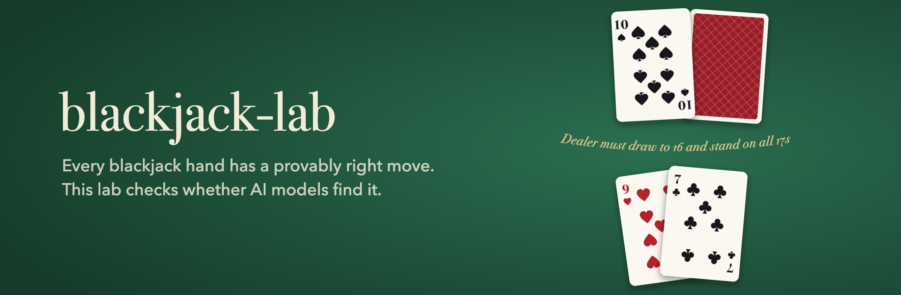

<p align="center"></p>

Blackjack has 200 decisions worth making, and dynamic programming solves every one of them exactly. That makes it a fair exam for decision models such as TypeSafe's Jev, because every probability a model states can be checked against the true one.

The lab asks two questions. The first is calibration, whether a model that is 70% sure is right 70% of the time. The second is teaching, whether a model's judgment, used as a prior that fades out, lets a Q-learning agent reach optimal play in fewer hands without changing where it converges.

## Status

The scaffold is in place. The build follows [`docs/plan.md`](docs/plan.md) batch by batch, and each batch ships with a marimo notebook that explains the idea it adds.

## Run it

```bash
make setup      # uv sync with every extra and the dev tools
make check      # lint, types, layer contracts, tests, 100% branch coverage on core
make notebooks  # open the lessons
```

Teachers are optional extras (`jev`, `local`, `llm`). Their answers are cached in `data/priors/`, so every experiment replays without an API key.

## Layout

```
src/blackjack_lab/core       game, exact solver, learning, metrics (stdlib + numpy)
src/blackjack_lab/adapters   model clients and the prior cache
src/blackjack_lab/app        settings, CLI, HTTP API
notebooks/                   the lessons, as plain Python
docs/                        design, plan, architecture, decisions
```

## Reading

- Sutton and Barto, *Reinforcement Learning: An Introduction*, chapters 4 to 6
- Guo et al., *On Calibration of Modern Neural Networks*, 2017
- *Can Jev be Your Q or Policy in Reinforcement Learning?*, arXiv 2610.11692

## License

MIT, see [`LICENSE`](LICENSE).
